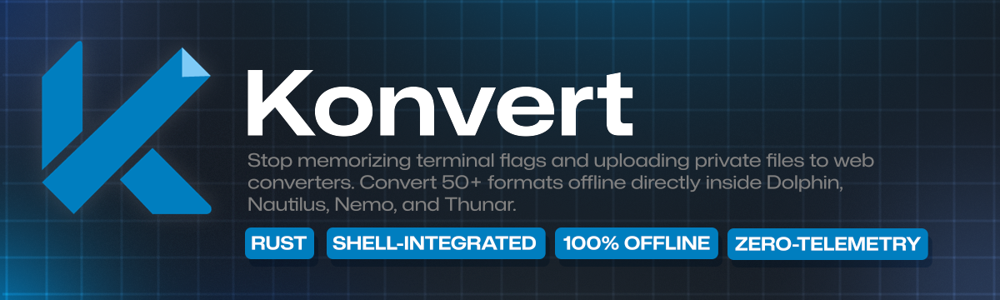
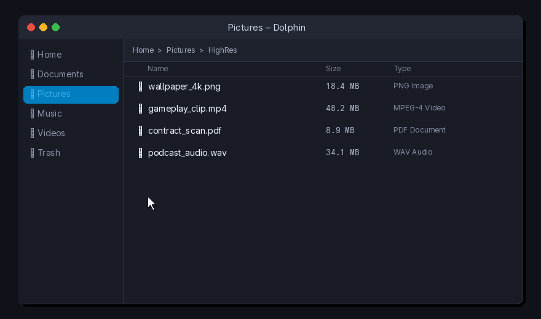
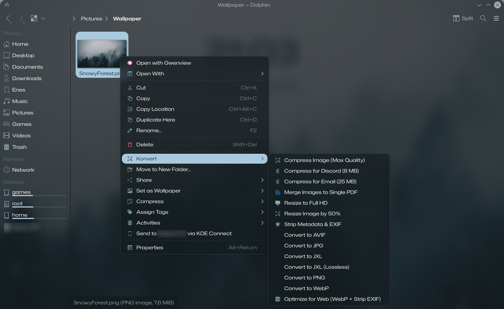
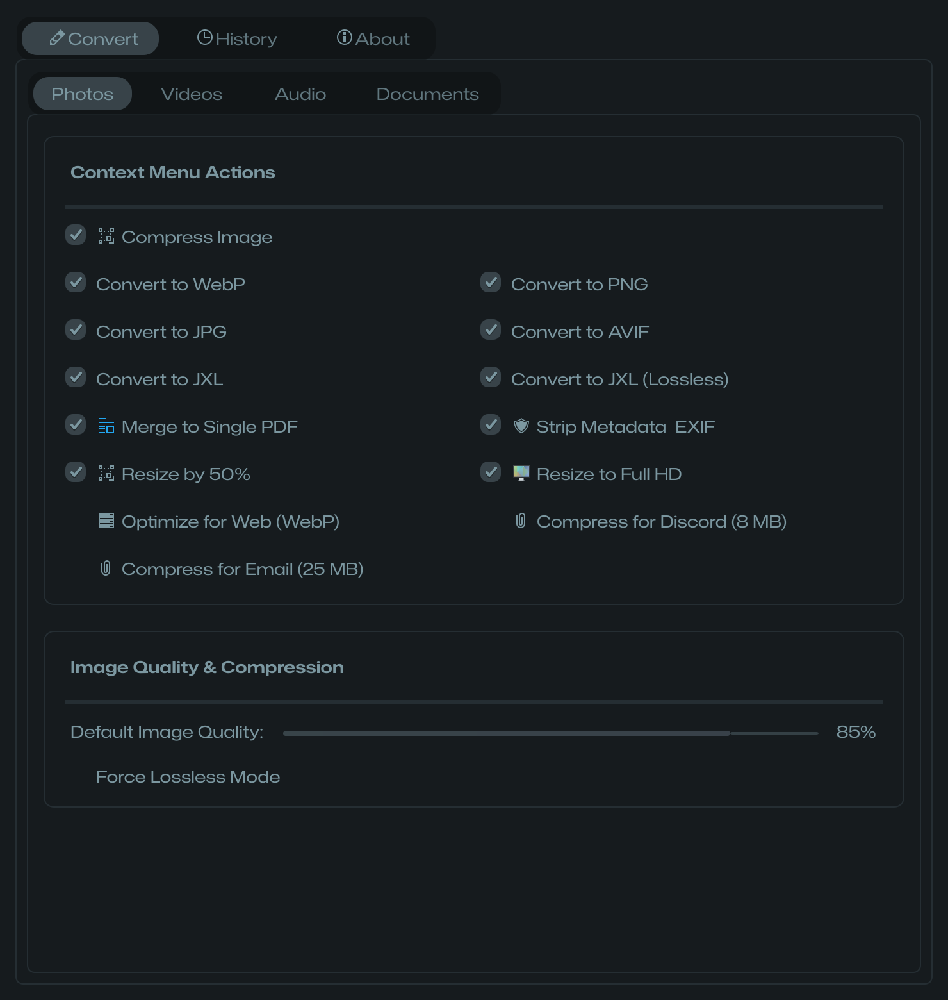
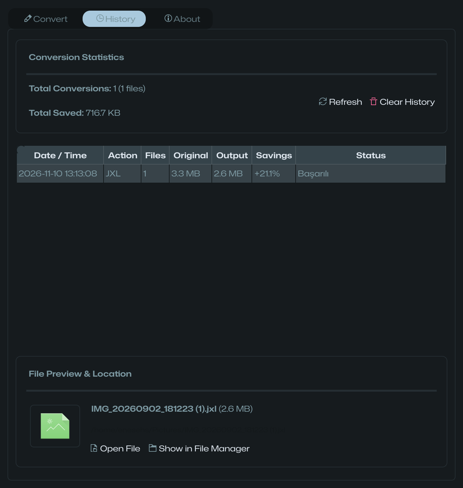
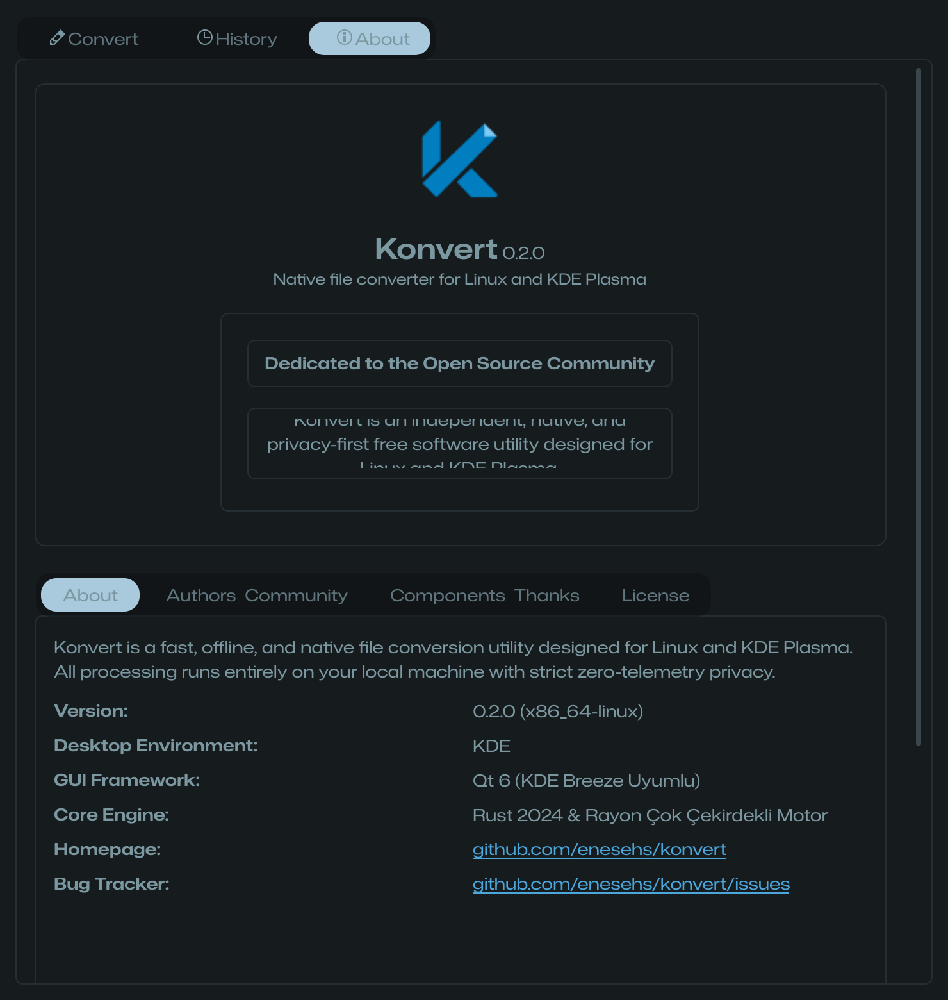
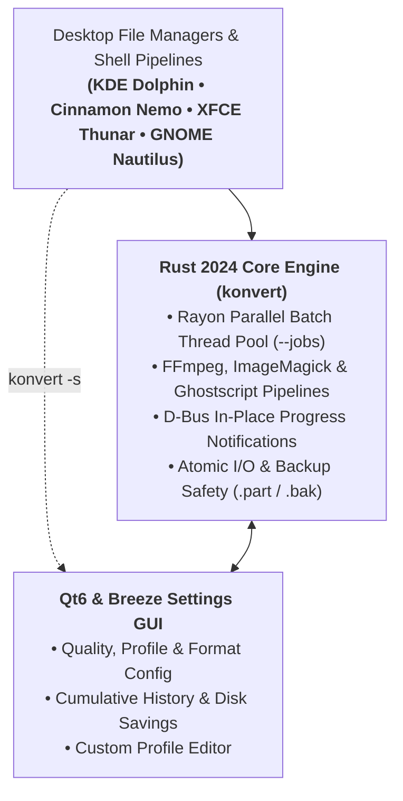

<div align="center">

  <a href="https://enesehs.dev/konvert">
    
  </a>

  <br><br>

  **English** • [Türkçe](README_tr.md) • [Deutsch](README_de.md) • [Français](README_fr.md) • [Español](README_es.md) • [Italiano](README_it.md) • [Русский](README_ru.md) • [中文](README_zh.md) • [日本語](README_ja.md)

  <br>

  [](https://enesehs.dev/konvert)
  [](https://github.com/enesehs/konvert/actions/workflows/build.yml)
  [](https://github.com/enesehs/konvert/releases)
  [](https://www.gnu.org/licenses/gpl-3.0.html)

  <br>

  <p align="center">
    <b>Ultra-fast, lightweight, 100% offline native right-click file converter & optimizer for Linux and all major desktop file managers.</b>
  </p>

  <p align="center">
    🌐 <b>Interactive Web Demo & FAQ:</b> <a href="https://enesehs.dev/konvert"><b>enesehs.dev/konvert</b></a>
  </p>

  <p align="center">
    <a href="#quick-start">Quick Start</a> •
    <a href="#why-konvert">Why Konvert?</a> •
    <a href="#benchmarks">Benchmarks</a> •
    <a href="#screenshots">Screenshots</a> •
    <a href="#features">Features</a> •
    <a href="#installation">Installation</a> •
    <a href="#cli-usage">CLI Usage</a> •
    <a href="#architecture">Architecture</a>
  </p>

  <br>

  <a href="https://enesehs.dev/konvert">
    
  </a>

</div>

---

## Quick Start

Get up and running in seconds:

```bash
# 1. Install via universal script (or build from source)
curl -sSL https://enesehs.dev/konvert/install.sh | bash

# 2. Convert or optimize any file instantly (CLI or right-click in file manager)
konvert -t webp photo.png

# 3. Open the native Qt6 & Breeze settings panel
konvert -s
```

---

## Why Konvert?

Tired of uploading private files to online converter sites, switching to browser tabs, or waiting for bloated Electron apps?

* 🛡️ **Zero Telemetry & 100% Privacy:** Every single byte stays on your local hardware; zero network requests or background telemetry.
* 🖱️ **Native Right-Click Menus:** Instant right-click integration for **KDE Dolphin**, **Cinnamon Nemo**, **XFCE Thunar**, and **GNOME Nautilus**.
* ⚡ **Rust 2024 & Rayon Parallelism:** Multi-threaded parallel batch execution with zero GC pauses and ~25 MB peak memory footprint.
* 🎯 **Mathematical Target Sizing:** Compress videos and images to strict limits (Discord 8 MB, Email 25 MB) with automated ladder search.
* 🔔 **Live In-Place Plasma Notifications:** Dynamic animated progress bars and live ETA updates in your desktop notification center.
* 📊 **Audit History & Savings:** Track cumulative disk space savings, preview 80×80 thumbnails, and reveal files in one click.

👉 *Explore full interactive comparison and feature deep-dives at [enesehs.dev/konvert](https://enesehs.dev/konvert).*

---

## Benchmarks

Tested on AMD Ryzen 7 (8 cores / 16 threads), converting a **19.4 MB 4K PNG** (`3840×2160`):

| Operation | Target / Mode | Output Size | Disk Saved | Time (Single) | Time (Rayon `-j 8` Batch ×50) |
|---|---|---|---|---|---|
| **JPEG XL (`.jxl`)** | `--lossless` | 1.5 MB | **-92.2%** | 517 ms | **3.8s** (~3.9× speedup) |
| **WebP (`.webp`)** | `-q 85` | 1.9 MB | **-90.2%** | 843 ms | **5.4s** (~4.1× speedup) |
| **JPEG (`.jpg`)** | `-q 90` | 4.1 MB | **-78.8%** | 228 ms | **1.6s** (~3.8× speedup) |
| **Unix Pipe (`-`)** | Stdin ➔ Stdout | Stream | — | **37 ms** latency | — |

*Zero Electron/JVM runtime overhead. Base resident memory (RSS): ~24–28 MB.*

---

## Screenshots

<div align="center">
  <sub><b>Desktop Right-Click Context Menu Integration</b></sub><br>
  <a href="assets/screenshots/screenshot_context_menu.png">
    
  </a>
</div>

<br>

<table align="center" width="100%">
  <tr>
    <td width="33.3%" align="center" valign="top">
      <sub><b>Qt6 & Breeze Settings GUI</b></sub><br>
      <a href="assets/screenshots/screenshot_convert.png">
        
      </a>
    </td>
    <td width="33.3%" align="center" valign="top">
      <sub><b>Conversion History & Disk Savings</b></sub><br>
      <a href="assets/screenshots/screenshot_history.png">
        
      </a>
    </td>
    <td width="33.3%" align="center" valign="top">
      <sub><b>KDE Developer About Dialog</b></sub><br>
      <a href="assets/screenshots/screenshot_about.png">
        
      </a>
    </td>
  </tr>
</table>

---

## Features

| Feature | Description |
|---|---|
|  **Multi-Desktop Integration** | Separated context actions for Photos, Videos, Audio, and Documents without MIME-type pollution across Dolphin, Nemo, Thunar, and Nautilus. |
|  **Rust 2024 Rayon Engine** | Multi-threaded parallel batch execution with configurable thread budgets (`--jobs`), zero GC pauses, and LTO-optimized release binaries. |
|  **Preset Profiles** | Built-in presets (`web`, `balanced`, `archive`, `lossless`) plus custom profile creation (`--save-profile <name>`) saved in `config.toml`. |
|  **Unix Pipeline (`-`)** | Direct stdin/stdout streaming with automatic magic-byte format identification for shell pipelines. |
|  **Atomic Data Safety** | All file writes use temporary `.part` files with atomic commits, collision avoidance (`_2`, `_3`), and optional `.bak` backups (`--backup`). |
|  **Next-Gen Image Formats** | Native support for JPEG XL (`.jxl`), AVIF, QOI, WebP, HEIC, ICO, BMP, TIFF, and raster-to-SVG vectorization via `potrace`. |
|  **Document & PDF Tools** | Direct UDF (UYAP) and DOCX to PDF/TXT conversions with structural table and header extraction, plus multi-image PDF merge. |
|  **Multi-Language (i18n)** | 9 localized languages in CLI (`--lang <code>`: EN, TR, DE, FR, ES, IT, RU, ZH, JA) and 5 in the Qt6 Settings GUI. |

---

## Installation

### Method 1: Universal One-Line Installer (Recommended)

Installs the precompiled release binary, icons, shell completions, and file manager service menus:

```bash
curl -sSL https://enesehs.dev/konvert/install.sh | bash
```

> [!TIP]
> **Audit before running:** You can inspect the installer source at [`docs/public/install.sh`](docs/public/install.sh) or verify its checksum:
> ```bash
> curl -sSL https://enesehs.dev/konvert/install.sh -o /tmp/install.sh
> echo "faccff6b8e0601a1dce2d3efb215a69cfe08f748a557b6c01a4375236d3c8c0c  /tmp/install.sh" | sha256sum -c
> bash /tmp/install.sh
> ```

### Method 2: Debian / Ubuntu (.deb Package)

Download the `.deb` release package from [GitHub Releases](https://github.com/enesehs/konvert/releases) or build it locally:

```bash
# Install package:
sudo dpkg -i packaging/konvert_*.deb
sudo apt-get install -f

# Or build from repository:
./packaging/build-deb.sh
```

### Method 3: Arch Linux / AUR (PKGBUILD)

```bash
cd packaging
makepkg -si
```

### Method 4: Portable AppImage

```bash
# Build standalone AppImage bundle:
./packaging/build-appimage.sh
```

### Method 5: Flatpak (Flathub Manifest)

```bash
flatpak-builder --user --install --force-clean build-dir packaging/io.github.enesehs.konvert.json
```

### Method 6: Local Build from Source

```bash
git clone https://github.com/enesehs/konvert.git
cd konvert
./scripts/install.sh
```

---

## CLI Usage

Konvert provides a clean, predictable CLI interface with full flag validation:

```bash
# ── Preset Profiles & Pipeline ─────────────────────────────────────────
konvert --profile web -t webp photo.png       # Apply web profile (80% quality, 150 DPI)
konvert --profile archive -t jpg photo.png     # Apply archive profile (95% quality, 600 DPI)
konvert --profile lossless -t webp photo.png  # Lossless encoding mode
konvert --list-profiles                       # List available built-in and user profiles
cat photo.png | konvert -t webp - > out.webp  # Stream conversion via stdin/stdout pipe

# ── Smart Target Size Compression ──────────────────────────────────────
konvert -t discord_8mb video.mp4              # Compress video mathematically to fit 8 MB
konvert -t email_25mb video.mp4               # Compress video to fit 25 MB
konvert --target-size 15MB video.mp4          # Custom target size constraint

# ── Image Conversion & Optimization ────────────────────────────────────
konvert -t webp -q 90 photo.png                # WebP with explicit quality setting
konvert -t jxl --lossless photo.png            # Lossless JPEG XL conversion
konvert -t avif photo.png                      # AVIF next-generation conversion
konvert -t svg photo.png                       # Vectorize raster image to SVG contours
konvert -t resize_50 photo.png                 # Downscale resolution by 50%
konvert -t resize_1080p photo.jpg              # Fit within Full HD (1920x1080) bounds
konvert -t strip-metadata photo.jpg            # Strip EXIF, GPS, and sensor metadata

# ── Document & PDF Tools ───────────────────────────────────────────────
konvert --merge-pdf p1.png p2.jpg p3.webp     # Merge multiple images into a single PDF
konvert -t pdf document.udf                    # Convert UDF document directly to PDF
konvert -t txt document.docx                   # Extract formatted text and tables from DOCX

# ── Video & Audio Utilities ────────────────────────────────────────────
konvert -t gif video.mp4                       # High-quality two-pass palette GIF
konvert -t extract-audio video.mp4             # Extract audio stream as MP3
konvert --extract-frames video.mp4             # Extract video frames into folder as PNGs
konvert -t audio-to-video song.mp3             # Generate waveform MP4 video from audio

# ── Batch Processing & Safety Controls ─────────────────────────────────
konvert -t webp -j 4 *.png                    # Parallel batch conversion with 4 CPU threads
konvert -r -t webp ./photos                    # Recursively scan and convert directories
konvert --dry-run -t webp *.jpg                # Preview output paths and collision plan
konvert --backup -f -t png photo.jpg           # Overwrite safely with automatic .bak backup
konvert --check-update                         # Check GitHub releases for software updates
konvert --cancel                               # Safely cancel ongoing background conversion
konvert -s                                     # Open Qt6 Settings GUI
```

---

## Supported Formats

| Category | Input Formats | Target Formats | Engine Capabilities |
|---|---|---|---|
|  **Photos** | PNG, JPG, JPEG, WebP, AVIF, JXL, SVG, BMP, ICO, TIFF, QOI, HEIC | WebP, PNG, JPG, SVG, ICO, HEIC, BMP, AVIF, JXL, TIFF, QOI | EXIF Auto-Orientation, EXIF Stripping, 50% & 1080p Resizing, Multi-Image PDF Merge, Potrace Tracing |
|  **Videos** | MP4, MKV, WebM, AVI, MOV, FLV, TS, WMV | MP4, MKV, WebM, GIF | Discord 8 MB, Email 25 MB, Custom Target Sizing, Frame Extraction, Audio Extraction, Two-Pass Palette GIF |
|  **Audio** | MP3, WAV, FLAC, OGG, Opus, AAC, M4A | MP3, WAV, FLAC, OGG, Opus, AAC, M4A | Configurable Bitrates (`128k` to `320k`), Waveform Video (MP4) Generation |
|  **Documents** | UDF (UYAP), DOCX, PDF, TXT | PDF, PNG, JPG, TXT | Multi-DPI Page Rendering (36-1200 DPI), Ghostscript Optimization, DOCX/UDF Table & Text Extraction |

---

## Architecture



---

## Contributing

Contributions are welcome and appreciated! To contribute:

1. Fork the repository.
2. Create your feature branch (`git checkout -b feature/amazing-feature`).
3. Commit your changes (`git commit -m 'feat: add amazing feature'`).
4. Ensure tests and lints pass (`cargo test && cargo clippy --all-targets -- -D warnings`).
5. Push to your branch (`git push origin feature/amazing-feature`).
6. Open a **Pull Request**.

---

## License

This project is licensed under the **GNU General Public License v3.0 or later (GPL-3.0-or-later)**. See the [LICENSE](LICENSE) file for details.

---

<div align="center">
  <b>Developer:</b> <a href="https://github.com/enesehs">enesehs</a> &bull;
  <b>Contact:</b> <a href="mailto:enesehs@protonmail.com">enesehs@protonmail.com</a><br>
  <sub>Crafted with dedication for Linux and the Open Source Community.</sub>
</div>
