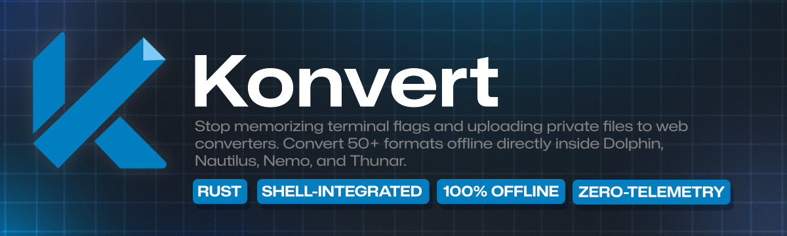
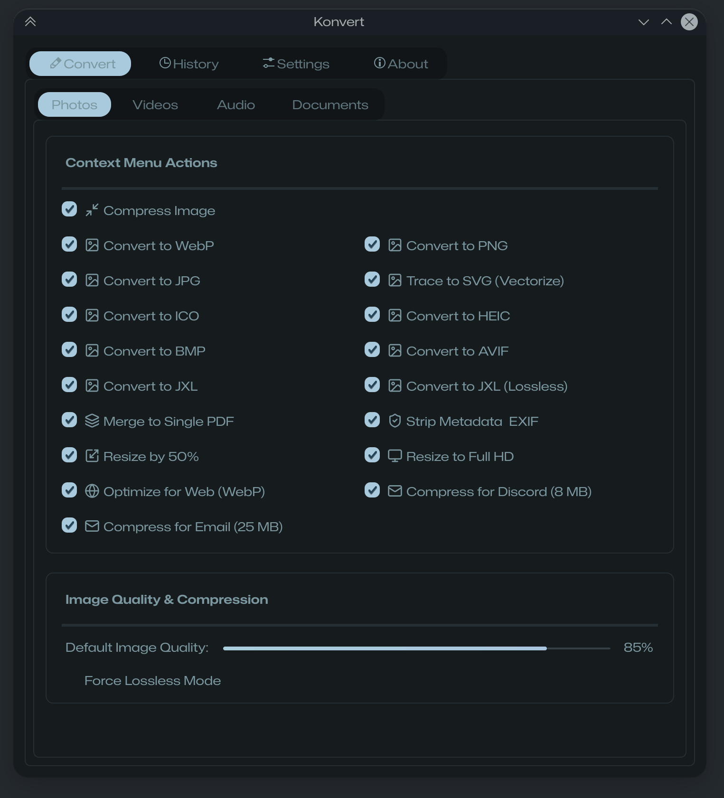
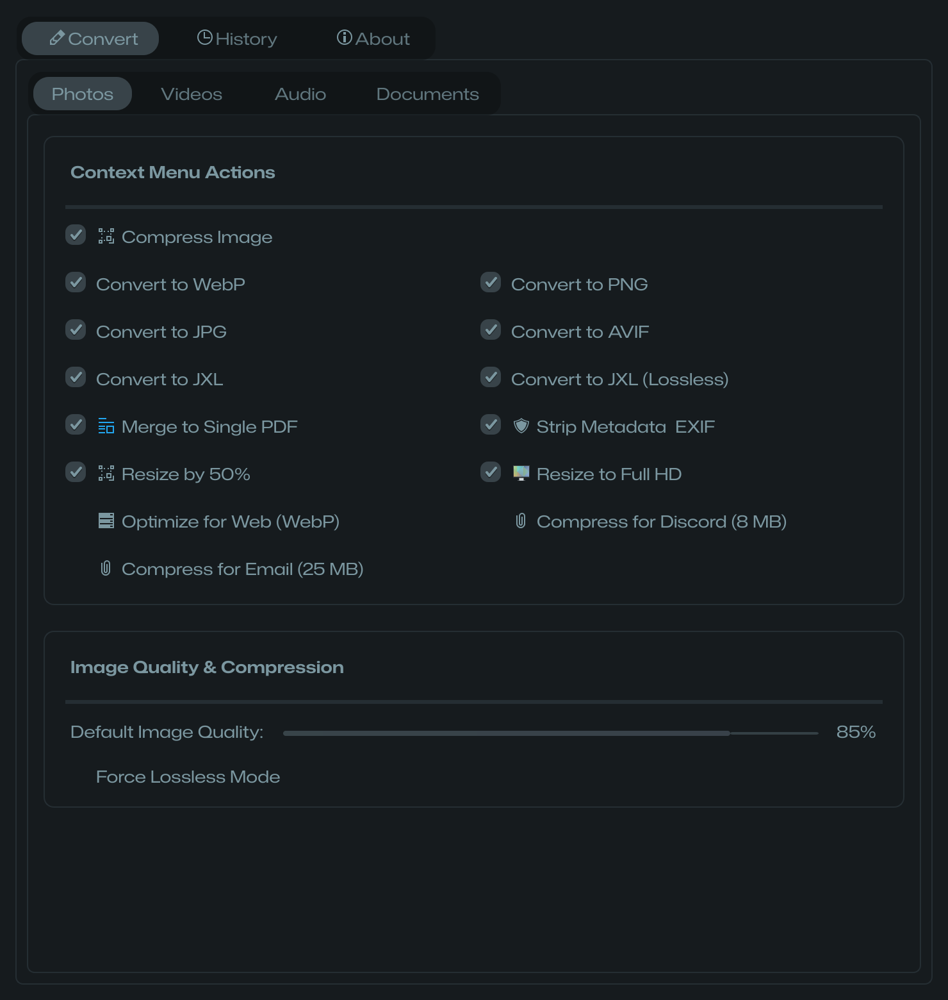
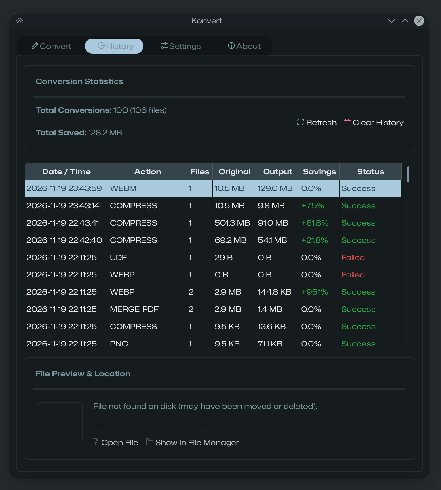
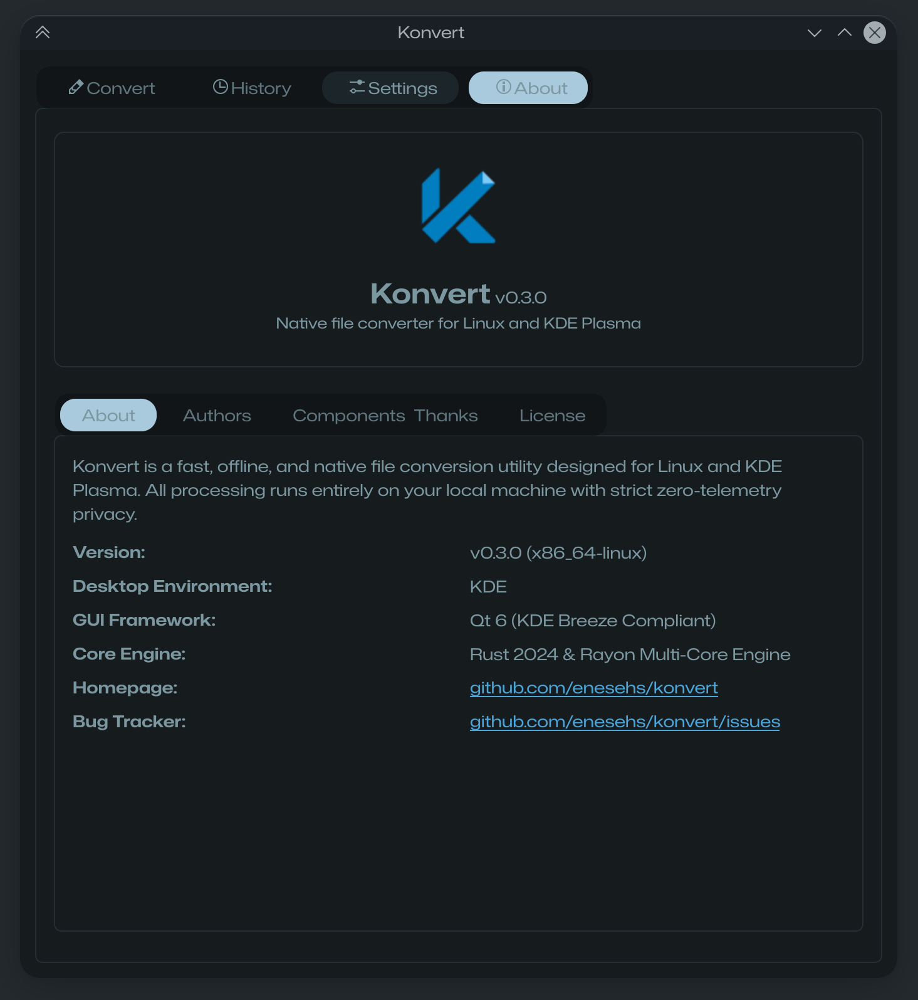
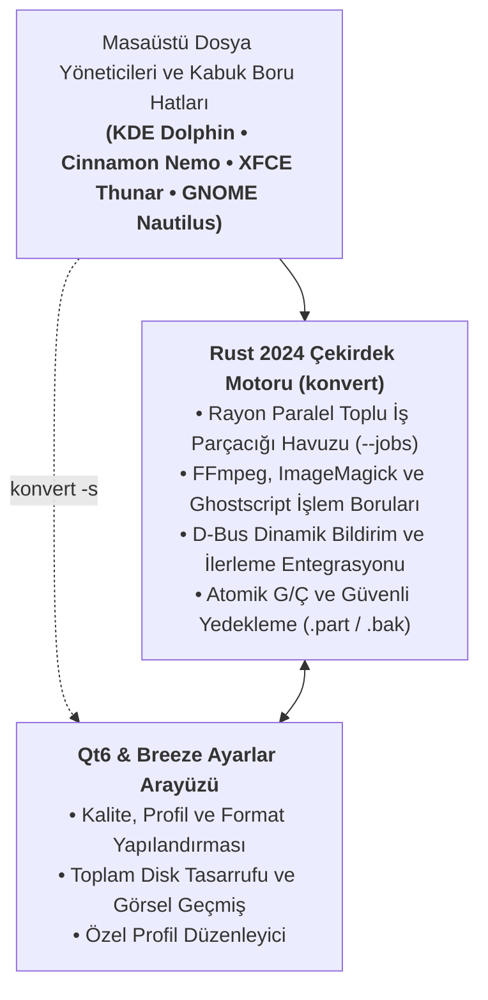

<div align="center">

  <a href="https://enesehs.dev/konvert">
    
  </a>

  <br><br>

  [English](README.md) • **Türkçe**

  <br>

  [](https://enesehs.dev/konvert)
  [](https://github.com/enesehs/konvert/actions/workflows/build.yml)
  [](https://github.com/enesehs/konvert/releases)
  [](https://www.gnu.org/licenses/gpl-3.0.html)

  <br>

  <p align="center">
    <b>Linux ve tüm büyük masaüstü dosya yöneticileri için hızlı, hafif, %100 çevrimdışı yerel sağ tık dosya dönüştürücüsü ve optimize edicisi.</b>
  </p>

  <p align="center">
     <b>Etkileşimli Canlı Demo ve SSS:</b> <a href="https://enesehs.dev/konvert"><b>enesehs.dev/konvert</b></a>
  </p>

  <p align="center">
    <a href="#hızlı-başlangıç">Hızlı Başlangıç</a> •
    <a href="#neden-konvert">Neden Konvert?</a> •
    <a href="#performans-ve-kıyaslama">Performans</a> •
    <a href="#ekran-görüntüleri">Ekran Görüntüleri</a> •
    <a href="#özellikler">Özellikler</a> •
    <a href="#kurulum">Kurulum</a> •
    <a href="#cli-kullanımı">CLI Kullanımı</a> •
    <a href="#mimari">Mimari</a>
  </p>

  <br>

<div align="center">
  <video src="https://github.com/user-attachments/assets/e7fbf3ad-e3cf-4256-a340-00aad7f257c6" width="90%" controls autoplay loop muted></video>
</div>

</div>

---

## Hızlı Başlangıç

Saniyeler içinde kullanmaya başlayın:

```bash
# 1. Evrensel kurulum betiği ile kurun (veya kaynaktan derleyin)
curl -sSL https://enesehs.dev/konvert/install.sh | bash

# 2. Herhangi bir dosyayı anında dönüştürün veya optimize edin (CLI veya sağ tık ile)
konvert -t webp gorsel.png

# 3. Yerel Qt6 ve Breeze ayarlar panelini açın
konvert -s
```

---

## Neden Konvert?

Gizli dosyalarınızı çevrimiçi dönüştürücü sitelerine yüklemekten, tarayıcı sekmeleriyle uğraşmaktan veya hantal Electron uygulamalarının açılmasını beklemekten sıkıldınız mı?

*  **Sıfır Telemetri & %100 Gizlilik:** Her bir bayt yalnızca yerel donanımınızda işlenir; tüm dönüştürmeler sıfır telemetri ile %100 çevrimdışı çalışır (ağ bağlantısı yalnızca kullanıcı açıkça `--check-update` çalıştırırsa kurulur).
*  **Yerel Sağ Tık Menüleri:** **KDE Dolphin**, **Cinnamon Nemo**, **XFCE Thunar** ve **GNOME Nautilus** üzerinde doğrudan sağ tıklayarak dönüştürün.
*  **Rust 2024 & Rayon Paralelliği:** Sıfır GC duraklaması ve ~25 MB bellek kullanımıyla çok çekirdekli paralel toplu işleme.
*  **Matematiksel Hedef Boyutlandırma:** Medyayı kesin boyut sınırlarına (Discord 8 MB, E-posta 25 MB) otomatik ayar arayışıyla sığdırın.
*  **Canlı D-Bus İlerleme Bildirimleri:** Masaüstü bildirim merkezinizde dinamik animasyonlu ilerleme çubuğu ve anlık kalan süre (ETA) tahmini.
*  **Görsel Geçmiş ve Tasarruf Takibi:** Toplam disk alanı tasarrufunu izleyin, 80×80 küçük resim önizlemelerine bakın ve dosyaları tek tıkla açın.

 *Kapsamlı etkileşimli karşılaştırma ve detaylar için: [enesehs.dev/konvert](https://enesehs.dev/konvert).*

---

## Performans ve Kıyaslama

AMD Ryzen 7 7800X3D (8 çekirdek / 16 iş parçacığı) üzerinde [`scripts/benchmark.py`](scripts/benchmark.py) ile ölçülmüştür.

### Paralel Toplu İşleme ve Hızlanma (12.7 MB 4K `3840x2160` PNG)

| İşlem | Kip / Ayar | Çıktı Boyutu | Disk Tasarrufu | Yalın Araç (Tek Dosya) | Konvert (Tek Dosya) | Konvert (Rayon `-j 8` ×50) |
|---|---|---|---|---|---|---|
| **JPEG XL (`.jxl`)** | `--lossless` | 12.4 MB | **-%2.4** | 1.02 sn (`cjxl`) | 1.02 sn | **43.89 sn** (Seri `cjxl`'e göre ~1.2×) |
| **WebP (`.webp`)** | `-q 85` | 849.2 KB | **-%93.5** | 604 ms (`magick`) | 600 ms | **4.62 sn** (Seri `magick`'e göre ~6.5×) |
| **JPEG (`.jpg`)** | `-q 90` | 2.2 MB | **-%82.3** | 194 ms (`magick`) | **187 ms** (`image-rs`) | **1.52 sn** (Seriye göre ~6.2×) |
| **Unix Boru Hattı (`-`)** | Stdin -> Stdout (1080p) | Akış | — | — | **152 ms** gecikme | — |

*Performans Modeli ve Ayrımı: Konvert JPEG çıktısı için harici süreç açmadan doğrudan bellekte yerel Rust `image-rs` (`JpegEncoder`) kullanır; WebP/JXL/video/belgelerde ise kabuk yorumlayıcı masrafı olmadan yerel araçları (`magick`, `cjxl`, `ffmpeg`) çağırır. Toplu işlemlerde Rayon iş parçacığı havuzu (`-j 8`) tek iş parçacıklı kodlayıcılarda (`magick`, `image-rs`) ~6.2–6.5× hızlanma sağlar. (`cjxl` dahili çoklu iş parçacığı kullandığı için çoklu örnek hızlanması çekirdek payına bağlıdır.)*

*Sıfır Electron/JVM çalışma zamanı yükü. Taban bellek kullanımı (RSS): ~24–28 MB (Rust çekirdek süreci). Not: 4K video dönüştürme veya büyük PDF işlemlerinde tepe bellek kullanımı FFmpeg ve Ghostscript alt süreçleri tarafından belirlenir.*

### Kalite ve Sadakat Ölçümleri (PSNR, SSIM ve SNR)

1080p referans medyalarıyla ölçülmüştür:

#### Görsel Kalite Analizi (1080p Referans Kare)

| Format / Profil | Çıktı Boyutu | Disk Tasarrufu | Süre | PSNR (dB) | SSIM (Yapısal Benzerlik) |
|---|---|---|---|---|---|
| **WebP (`-q 85`)** | 70.6 KB | **-%97.3** | 128.8 ms | 37.67 dB | **0.9985** |
| **JPEG XL (`.jxl`)** | 72.7 KB | **-%97.3** | 140.8 ms | 40.14 dB | **0.9984** |
| **AVIF (`-q 80`)** | 35.4 KB | **-%98.7** | 1106.6 ms | 42.31 dB | **0.9983** |
| **JPEG (`-q 90`)** | 212.2 KB | **-%92.0** | 54.9 ms | 42.67 dB | **0.9989** |
| **WebP (`--lossless`)** | 820.5 KB | **-%69.1** | 49.7 ms | 61.59 dB | **1.0000** |

#### Video, Ses ve Belge Sadakati

| Hedef / Profil | Referans | Çıktı Boyutu | Disk Tasarrufu | Kalite Metriği |
|---|---|---|---|---|
| **Discord 8MB Profili** | 1080p MP4 (20.6 MB) | 6.98 MB | **-%66.1** | **40.05 dB PSNR** / **0.9906 SSIM** |
| **MP3 (320 kbps)** | 48 kHz WAV (375 KB) | 158.5 KB | **-%57.7** | **74.18 dB SNR** |
| **MP3 (192 kbps)** | 48 kHz WAV (375 KB) | 95.1 KB | **-%74.6** | **30.46 dB SNR** |
| **FLAC Ses** | 48 kHz WAV (375 KB) | 97.2 KB | **-%74.1** | **Kayıpsız (Tam Eşleşme)** |
| **DOCX -> TXT** | `source_doc.docx` | 682 B | — | **%100 Kelime / Karakter Doğruluğu** |
| **UDF (UYAP) -> TXT** | `source_court.udf` | 519 B | — | **%100 Kelime / Karakter Doğruluğu** |

*Hız ölçümlerini yerel ortamınızda dilediğiniz an `python3 scripts/benchmark.py` ile tekrarlayabilirsiniz.*

---

## Ekran Görüntüleri

<div align="center">
  <sub><b>Masaüstü Sağ Tık Bağlam Menüsü Entegrasyonu</b></sub><br>
  <a href="assets/screenshots/screenshot_context_menu.png">
    
  </a>
</div>

<br>

<table align="center" width="100%">
  <tr>
    <td width="33.3%" align="center" valign="top">
      <sub><b>Qt6 & Breeze Ayarlar Arayüzü</b></sub><br>
      <a href="assets/screenshots/screenshot_convert.png">
        
      </a>
    </td>
    <td width="33.3%" align="center" valign="top">
      <sub><b>Dönüşüm Geçmişi ve Tasarruf Paneli</b></sub><br>
      <a href="assets/screenshots/screenshot_history.png">
        
      </a>
    </td>
    <td width="33.3%" align="center" valign="top">
      <sub><b>KDE Geliştirici Hakkında İletişim Kutusu</b></sub><br>
      <a href="assets/screenshots/screenshot_about.png">
        
      </a>
    </td>
  </tr>
</table>

---

## Özellikler

| Özellik | Açıklama |
|---|---|
|  **Çoklu Masaüstü Desteği** | Dolphin, Nemo, Thunar ve Nautilus için MIME türü kirliliği yaratmayan Fotoğraf, Video, Müzik ve Belge bağlam eylemleri. |
|  **Rust 2024 Rayon Motoru** | Yapılandırılabilir iş parçacığı bütçeleri (`--jobs`), sıfır GC duraklaması ve LTO optimizasyonlu ikili dosya ile paralel toplu işleme. |
|  **Hazır ve Özel Profiller** | Yerleşik profiller (`web`, `balanced`, `archive`, `lossless`) ve `config.toml` dosyasına kaydedilen özel profil yönetimi (`--save-profile <isim>`). |
|  **Unix Boru Hattı Akışı (`-`)** | Kabuk boru hatları (pipeline) için otomatik sihirli bayt format tespiti ile doğrudan stdin/stdout akış desteği. |
|  **Atomik Veri Güvenliği** | Geçici `.part` dosyaları ile atomik yazma, çakışma koruması (`_2`, `_3`) ve isteğe bağlı `.bak` yedekleme (`--backup`). |
|  **Yeni Nesil Görsel Formatları** | JPEG XL (`.jxl`), AVIF, QOI, WebP, HEIC, ICO, BMP, TIFF, GIF desteği ve `potrace` ile SVG vektörel izleme (yoksa otomatik bitmap gömme yedeği). |
|  **Belge ve PDF Araçları** | Tablo ve başlıkları koruyan doğrudan UDF (UYAP) ve DOCX -> PDF/TXT dönüşümü ve çoklu görselden PDF birleştirme. |
|  **Çok Dilli (i18n) Destek** | Komut satırı, `--doctor` ve çekirdek hata mesajları 9 dilde yerelleştirilmiştir (`--lang <code>`: EN, TR, DE, FR, ES, IT, RU, ZH, JA); Qt6 Ayarlar arayüzü 5 dilde yerelleştirilmiş olup 9 dil seçimi sunar. |

---

## Kurulum

### Yöntem 1: Evrensel Tek Satır Kurucu (Önerilen)

En güncel derlenmiş ikili dosyayı, simgeleri, kabuk tamamlamalarını ve dosya yöneticisi bağlam menülerini kurar:

```bash
curl -sSL https://enesehs.dev/konvert/install.sh | bash
```

> [!TIP]
> **Çalıştırmadan önce denetleyin:** Kurulum betiğini [`docs/public/install.sh`](docs/public/install.sh) adresinden inceleyebilir veya sağlama toplamını doğrulayabilirsiniz:
> ```bash
> curl -sSL https://enesehs.dev/konvert/install.sh -o /tmp/install.sh
> curl -sSL https://enesehs.dev/konvert/install.sh.sha256 -o /tmp/install.sh.sha256
> (cd /tmp && sha256sum -c install.sh.sha256)
> bash /tmp/install.sh
> ```

### Yöntem 2: Debian / Ubuntu (.deb Paketi)

[GitHub Releases](https://github.com/enesehs/konvert/releases) sayfasından `.deb` paketini indirin veya yerel olarak derleyin:

```bash
# Paketi kurun:
sudo dpkg -i packaging/konvert_*.deb
sudo apt-get install -f

# Veya depodan derleyin:
./packaging/build-deb.sh
```

### Yöntem 3: Arch Linux / AUR (PKGBUILD)

```bash
cd packaging
makepkg -si
```

### Yöntem 4: Bağımsız AppImage

```bash
# AppImage paketini derleyin:
./packaging/build-appimage.sh
```

### Yöntem 5: Flatpak (Flathub Manifesti)

```bash
flatpak-builder --user --install --force-clean build-dir packaging/io.github.enesehs.konvert.json
```

### Yöntem 6: Kaynaktan Yerel Derleme

```bash
git clone https://github.com/enesehs/konvert.git
cd konvert
./scripts/install.sh
```

---

## CLI Kullanımı

Konvert, tam bayrak doğrulama ve korumaya sahip temiz ve öngörülebilir bir komut satırı arayüzü sunar:

```bash
# ── Hazır Profiller ve Boru Hattı ──────────────────────────────────────
konvert --profile web -t webp foto.png        # Web profilini uygula (%80 kalite, 150 DPI)
konvert --profile archive -t jpg foto.png      # Arşiv profili (%95 kalite, 600 DPI)
konvert --profile lossless -t webp foto.png   # Kayıpsız kodlama modu
konvert --list-profiles                        # Kullanılabilir hazır ve kullanıcı profillerini listele
cat foto.png | konvert -t webp - > cikti.webp # Stdin/stdout boru hattı üzerinden dönüştür

# ── Akıllı Hedef Boyut Sıkıştırma ──────────────────────────────────────
konvert -t discord_8mb video.mp4               # Videoyu matematiksel olarak 8 MB altına sıkıştır
konvert -t email_25mb video.mp4                # Videoyu 25 MB e-posta sınırına sıkıştır
konvert --target-size 15MB video.mp4           # Özel hedef boyut sınırı belirle

# ── Görsel Dönüştürme ve Optimizasyon ──────────────────────────────────
konvert -t webp -q 90 foto.png                 # Belirli kalite ayarı ile WebP dönüşümü
konvert -t jxl --lossless foto.png             # Kayıpsız JPEG XL dönüşümü
konvert -t avif foto.png                       # AVIF yeni nesil dönüşüm
konvert -t svg foto.png                        # Raster görseli SVG vektör konturlarına dönüştür
konvert -t resize_50 foto.png                  # Çözünürlüğü %50 küçült
konvert -t resize_1080p foto.jpg               # Full HD (1920x1080) sınırına sığdır
konvert -t strip-metadata foto.jpg             # EXIF, GPS ve sensör meta verilerini temizle

# ── Belge ve PDF Araçları ──────────────────────────────────────────────
konvert --merge-pdf s1.png s2.jpg s3.webp      # Birden çok görseli tek bir PDF olarak birleştir
konvert -t pdf belge.udf                       # UDF (UYAP) belgesini doğrudan PDF'e çevir
konvert -t txt belge.docx                      # DOCX belgesinden biçimlendirilmiş metin ve tablo çıkar

# ── Video ve Ses Araçları ──────────────────────────────────────────────
konvert -t gif video.mp4                        # Yüksek kaliteli iki geçişli paletli GIF üret
konvert -t extract-audio video.mp4              # Ses akışını MP3 olarak dışa aktar
konvert --extract-frames video.mp4              # Video karelerini klasöre PNG olarak çıkar
konvert -t audio-to-video sarki.mp3             # Sesten dalga formu görselleştirmeli MP4 video üret

# ── Toplu İşleme, Tanılama ve Canlı İş Kontrolü ─────────────────────────
konvert -t webp -j 4 *.png                     # 4 CPU çekirdeği ile paralel toplu dönüşüm
konvert -t mp4 --hwaccel auto video.mkv        # GPU donanım hızlandırma (VA-API / NVENC)
konvert -r -t webp ./fotograflar               # Klasörleri özyinelemeli tara ve dönüştür
konvert --dry-run -t webp *.jpg                 # Çıktı yollarını ve çakışma planını önizle
konvert --backup -f -t png foto.jpg            # Otomatik .bak yedeği ile güvenli üzerine yazma
konvert --doctor                               # Araç zincirini, GPU kodlayıcılarını ve ortamı doğrula
konvert --check-update                          # GitHub güncellemelerini denetle
konvert --pause                                # Arka planda süren işlemi duraklat
konvert --resume                               # Duraklatılan işlemi devam ettir
konvert --cancel                                # Arka planda süren işlemi güvenle iptal et
konvert -s                                      # Qt6 Ayarlar Arayüzünü Aç
```

---

## Desteklenen Formatlar

| Kategori | Girdi Formatları | Hedef Formatlar | Motor Yetenekleri |
|---|---|---|---|
|  **Fotoğraflar** | PNG, JPG, JPEG, WebP, AVIF, JXL, SVG, BMP, ICO, TIFF, QOI, HEIC, HEIF, GIF | WebP, PNG, JPG, SVG, ICO, HEIC, BMP, AVIF, JXL, TIFF, QOI | EXIF Otomatik Yönlendirme, EXIF Temizleme, %50 ve 1080p Yeniden Boyutlandırma, Çoklu Görselden PDF, Potrace SVG Vektörleme |
|  **Videolar** | MP4, MKV, WebM, AVI, MOV, FLV, TS, WMV, M4V | MP4, MKV, WebM, AV1, GIF | Discord 8 MB, E-posta 25 MB, Özel Hedef Boyutlandırma, Kayıpsız Metadata Temizleme, Kare/Ses Ayıklama, İki Geçişli GIF |
|  **Müzik / Ses** | MP3, WAV, FLAC, OGG, Opus, AAC, M4A, WMA, AIFF | MP3, WAV, FLAC, OGG, Opus, AAC, M4A | Yapılandırılabilir Bit Hızı (`128k` - `320k`), Kayıpsız Metadata Temizleme, Dalga Formu Videoları (MP4) Üretimi |
|  **Belgeler** | UDF (UYAP), DOCX, PDF | PDF, PNG, JPG, TXT, HTML | Çoklu DPI Sayfa Çizimi (36-1200 DPI), Ghostscript Optimizasyonu, DOCX/UDF Tablo, Metin ve HTML Çıkarımı |

---

## Mimari



---

## Güvenlik ve Tehdit Modeli

Konvert, sıfır telemetri ve %100 çevrimdışı çalışma prensibiyle tasarlanmıştır. Bununla birlikte, belirli dosya türlerinde sistemdeki harici araçlar delegatör olarak kullanıldığından, kullanıcıların ve sistem yöneticilerinin aşağıdaki güvenlik hususlarını dikkate alması önerilir:

* **Harici Delegatör Güvenliği:** Doküman ve vektör dönüşümleri sistemdeki harici ikililere (`gs` / Ghostscript, `magick` / ImageMagick, `soffice` / LibreOffice) devredilir. İnternetten indirilen veya güvenilmeyen kaynaklardan gelen dosyaları dönüştürürken bu araçların güncel tutulduğundan ve `/etc/ImageMagick-7/policy.xml` üzerindeki güvenlik kısıtlamalarının aktif olduğundan emin olunmalıdır.
* **Girdi Sanitizasyonu ve Enjeksiyon Koruması:** Konvert hiçbir harici komutu kabuk (`sh -c`) üzerinden çalıştırmaz. Tüm alt süreçler doğrudan POSIX `exec` dizi argümanlarıyla çağrılır ve dosya yolları katı bir sanitizasyondan geçirilir.
* **Hizmet Engelleme (DoS / Zip-Bomb) Koruması:** UDF ve DOCX XML ayrıştırmalarında zip-bomb saldırılarını önlemek için 50 MB'lık katı bir dekompresyon sınırı uygulanır.
* **Sistem Teşhisi:** Kurulu delegatörlerin durumunu, yollarını ve sürümlerini denetlemek için dilediğiniz zaman `konvert --doctor` komutunu çalıştırabilirsiniz.

---

## Katkıda Bulunma

Katkılarınız memnuniyetle karşılanır! Katkıda bulunmak için:

1. Depoyu forklayın.
2. Özellik dalınızı oluşturun (`git checkout -b feature/harika-ozellik`).
3. Değişikliklerinizi işleyin (`git commit -m 'feat: harika ozellik ekle'`).
4. Test ve lint kontrollerini çalıştırın (`cargo test && cargo clippy --all-targets -- -D warnings`).
5. Dalınıza gönderin (`git push origin feature/harika-ozellik`).
6. Bir **Pull Request** açın.

---

## Lisans

Bu proje **GNU Genel Kamu Lisansı v3.0 veya üstü (GPL-3.0-or-later)** ile lisanslanmıştır. Detaylar için [LICENSE](LICENSE) dosyasına göz atabilirsiniz.

---

<div align="center">
  <b>Geliştirici:</b> <a href="https://github.com/enesehs">enesehs</a> &bull;
  <b>Web Sitesi:</b> <a href="https://enesehs.dev">https://enesehs.dev</a><br>
  <sub>Linux ve Açık Kaynak Topluluğu için tutkuyla geliştirildi.</sub>
</div>
