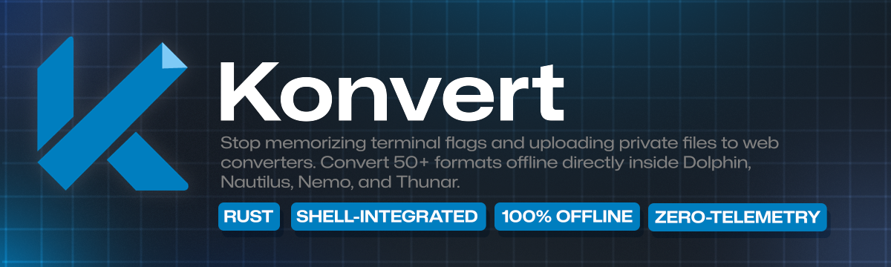
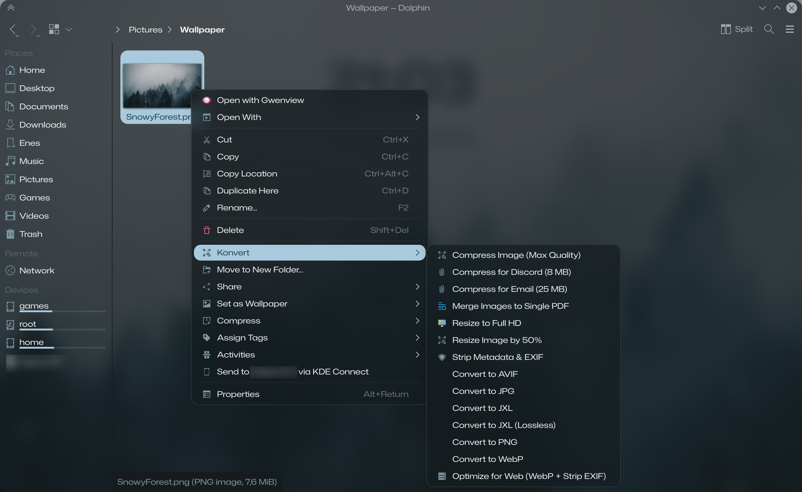
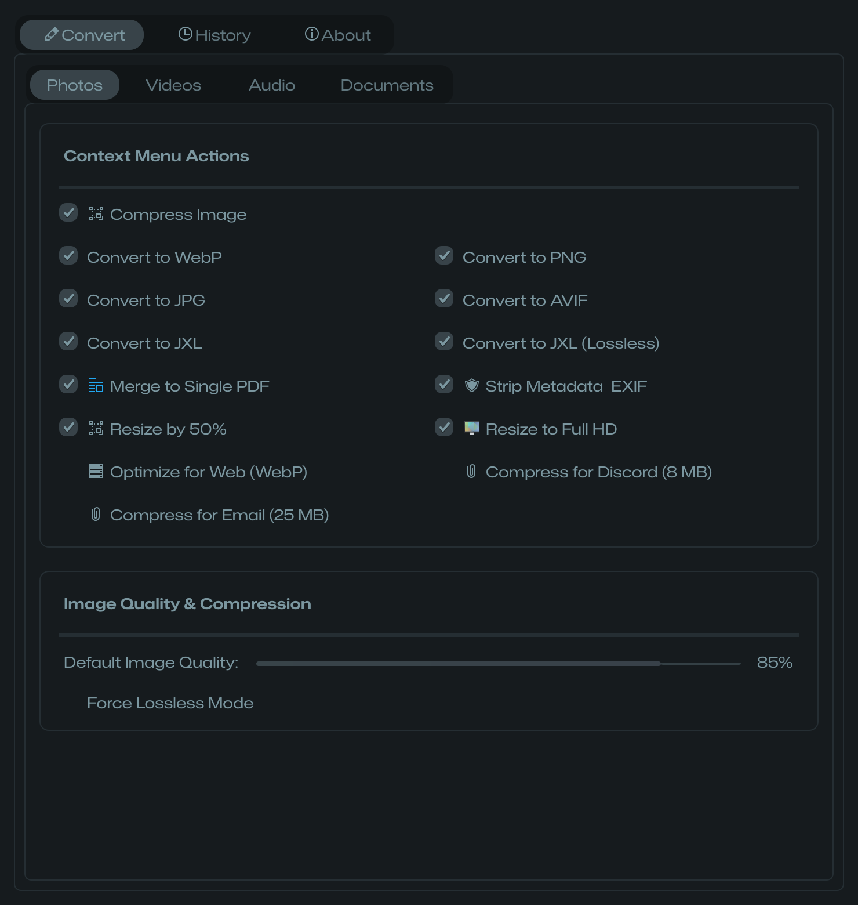
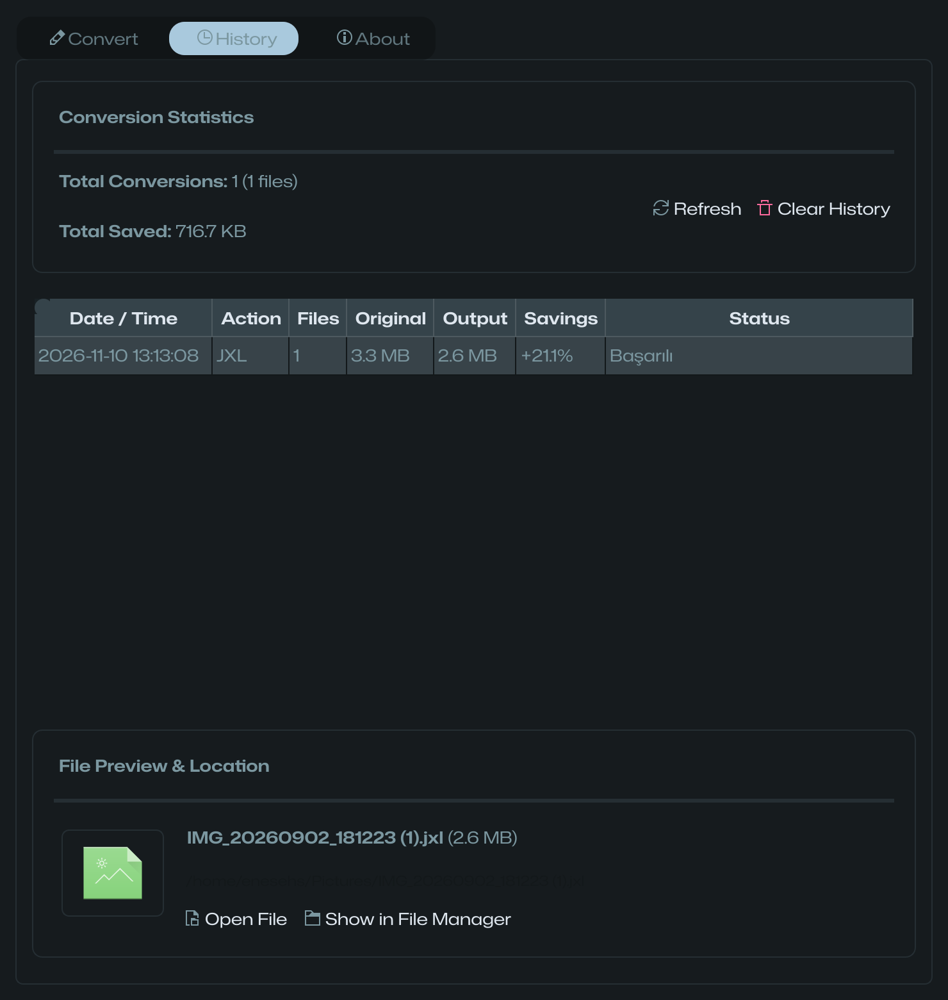
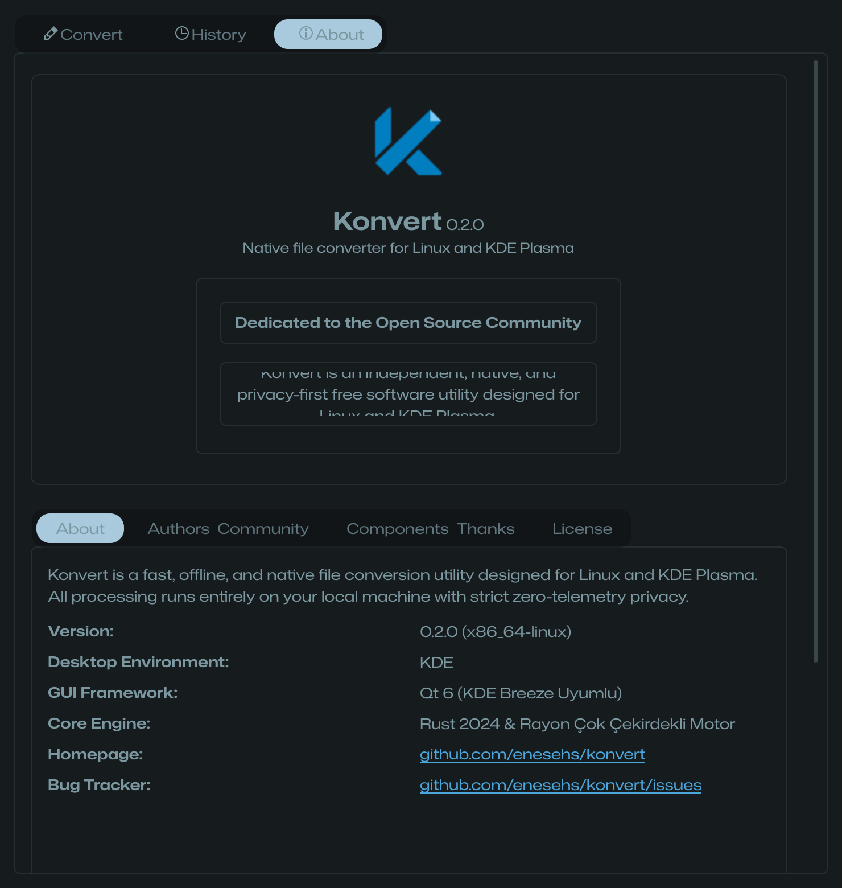

<div align="center">

  <a href="https://enesehs.dev/konvert">
    
  </a>

  <br>
  <br>

  **Türkçe** • [English](README.md)

  <br>
  <br>

  [](https://enesehs.dev/konvert)
  [](https://github.com/enesehs/konvert/releases)
  [](https://www.gnu.org/licenses/gpl-3.0.html)
  [](https://www.rust-lang.org/)
  [-41CD52?style=for-the-badge&logo=qt)](https://www.qt.io/)
  [](https://kde.org/)
  [](https://github.com/enesehs/konvert)

  <p align="center">
    <b>Linux ve KDE Plasma için ultra hızlı, hafif, tamamen çevrimdışı ve yerel sağ tık dosya dönüştürücüsü.</b><br>
    <i>Blazing fast, offline, and native file conversion & optimization utility for Linux and KDE Plasma.</i>
  </p>

  <p align="center">
    🚀 <b>Canlı İnteraktif Demo ve Web Sitesi: <a href="https://enesehs.dev/konvert">enesehs.dev/konvert</a></b>
  </p>

  <p align="center">
    <a href="#-özellikler">Özellikler</a> •
    <a href="#-ekran-görüntüleri">Ekran Görüntüleri</a> •
    <a href="#-kurulum">Kurulum</a> •
    <a href="#-akıllı-sıkıştırma-ve-cli-kullanımı">CLI Kullanımı</a> •
    <a href="#-desteklenen-formatlar">Formatlar</a> •
    <a href="#-paketleme-ve-dağıtım">Paketleme</a> •
    <a href="#-mimari">Mimari</a>
  </p>

</div>

---

## 🌟 Neden Konvert?

İnternetteki güvensiz web sitelerine dosyalarınızı yüklemekten, her dönüştürme için tarayıcı açmaktan veya hantal yazılımların dakikalarca açılmasını beklemekten yoruldunuz mu?

**Konvert**, modern Linux masaüstü ortamları ve özellikle **KDE Plasma 6 (Dolphin)** için sıfırdan geliştirildi:
* **Sıfır Telemetri & %100 Gizlilik:** Dosyalarınız cihazınızdan asla ayrılmaz. İnternet bağlantısı gerekmez; tüm işlemler yerel donanımınızın çoklu çekirdek gücüyle çalışır.
* **Sağ Tık (KIO ServiceMenu) Rahatlığı:** Dolphin içinde bir veya yüzlerce dosyayı seçip sağ tıklayarak saniyeler içinde dönüştürün.
* **Canlı Plasma İlerleme Bildirimi:** Tekil ve toplu dönüşümlerde Plasma 6 bildirim merkezinde animasyonlu ilerleme çubuğu (`progress bar`) gösterilir.
* **Akıllı Hedef Boyutlandırma:** Discord (8 MB) ve E-posta (25 MB) hedeflerine yönelik otomatik bit hızı hesabı; görsel/PDF çıktılarında boyut doğrulaması.
* **Önizlemeli İşlem Günlüğü:** Yapılan tüm işlemlerin boyut tasarruflarını takip edin, önizleme küçük resimlerine (thumbnail) bakın ve doğrudan Dolphin'de açın.

---

## 📸 Ekran Görüntüleri

<div align="center">

### Dolphin Sağ Tık Bağlam Menüsü Entegrasyonu
*Herhangi bir görsel veya medyaya sağ tıklayın; Konvert alt menüsüyle program açmadan anında dönüştürün*



<br><br>

### Modern Qt6 & KDE Breeze Ayarlar Arayüzü
*Kategori bazlı bağlam menüsü yönetimi, format sıkıştırma kalitesi ve önayarlar*



<br><br>

### İşlem Geçmişi & Dosya Önizleme Paneli
*Toplam disk alanı tasarruf istatistikleri, küçük resim önizlemesi ve hızlı dosya erişimi*



<br><br>

### Orijinal KDE Geliştirici "Hakkında" Paneli
*Açık kaynak topluluğu ithafı, 4 otantik KDE sekmesi ve çok dilli etkileşimli dil seçici*



</div>

---

## ✨ Özellikler

| Özellik | Açıklama |
|---|---|
| **Dolphin Sağ Tık Entegrasyonu** | Fotoğraflar, Videolar, Müzikler ve Belgeler için ayrıştırılmış, MIME türü kirliliği yaratmayan temiz KIO ServiceMenu'ler. |
| **Rust 2024 Çekirdek Motoru** | `Rayon` kütüphanesi ile yüzlerce dosyayı çoklu çekirdekle paralel işleme; sıfır GC gecikmesi ve ultra düşük bellek kullanımı. |
| **Akıllı Hedef Boyutlandırma** | `discord_8mb`, `email_25mb` ve `web_opt` profilleri ile otomatik matematiksel bit hızı hesabı. |
| **Yerel D-Bus İlerleme Çubuğu** | İşlemleri tek bir bildirim penceresinde canlı günceller (`in-place`), toast kirliliği yapmaz. |
| **Gelişmiş Belge ve Medya Araçları** | UDF (UYAP) belgelerini doğrudan PDF'e çevirme, görselleri tek PDF'te birleştirme, EXIF temizleme ve videodan ses ayıklama. |
| **Çok Dilli (i18n) Destek** | Otomatik sistem dili algılama; CLI'da 9 dil (TR, EN, DE, FR, ES, IT, RU, ZH, JA), ayar arayüzünde 5 dil. |

---

## 🚀 Kurulum

### Yöntem 1: Tek Komutla Hızlı Kurulum (Tavsiye Edilen)

Doğrudan tek komutla en son Konvert sürümünü, sistem simgelerini ve Dolphin bağlam menülerini sisteminize kurun:

```bash
# enesehs.dev üzerinden:
curl -sSL https://enesehs.dev/konvert/install.sh | bash

# Veya alternatif olarak GitHub üzerinden:
curl -sSL https://raw.githubusercontent.com/enesehs/konvert/main/docs/public/install.sh | bash
```

### Yöntem 2: Git Deposu ile Yerel Kurulum

```bash
git clone https://github.com/enesehs/konvert.git
cd konvert
./scripts/install.sh
```

### Yöntem 3: Debian / Ubuntu (.deb Paketi)

[GitHub Releases](https://github.com/enesehs/konvert/releases) sayfasından son `.deb` paketini indirin veya depodan derleyin:

```bash
# Hazır paketi kurun:
sudo dpkg -i packaging/konvert_*.deb
sudo apt-get install -f

# Veya paketi yerel olarak derleyin:
./packaging/build-deb.sh
```

### Yöntem 3: Arch Linux / AUR

```bash
cd packaging
makepkg -si
```

### Yöntem 4: Flatpak (Flathub Manifesti)

Konvert, doğrudan Flathub üzerinden dağıtıma uygun `packaging/io.github.enesehs.konvert.json` manifestine sahiptir:

```bash
flatpak-builder --user --install --force-clean build-dir packaging/io.github.enesehs.konvert.json
```

---

## 💻 Akıllı Sıkıştırma ve CLI Kullanımı

Konvert, hem Dolphin arayüzünden hem de terminal üzerinden doğrudan çağrılabilir:

```bash
# 🎯 Akıllı Hedef Boyuta Göre Sıkıştırma
konvert -t discord_8mb video.mp4     # Videoyu süresine göre tam 8 MB sınırına sıkıştırır
konvert -t email_25mb video.mp4       # E-posta ek sınırına (25 MB) otomatik sıkıştırır
konvert --target-size 15MB video.mp4  # Özel hedef boyut (15 MB) belirleme

# 🌐 Web İçin Tek Tıkla Optimizasyon
konvert -t web_opt resim.png          # %82 kalite WebP + sıfır EXIF / kişisel veri

# 🖼️ Görsel Format Dönüşümleri & Kalite Kontrolü
konvert -t webp -q 90 resim.png       # Belirli kaliteyle WebP dönüşümü
konvert -t jxl --lossless foto.png     # Yeni nesil kayıpsız JPEG XL sıkıştırması
konvert -t resize_50 foto.png         # Çözünürlüğü %50 yarıya indir
konvert -t resize_1080p foto.jpg      # Full HD (1920x1080) sınırına sığdır
konvert -t strip-metadata foto.jpg    # EXIF, GPS ve kamera etiketlerini temizle

# 📑 Belgeler ve PDF Birleştirme
konvert --merge-pdf foto1.png foto2.jpg foto3.webp  # Görselleri tek bir PDF'te topla
konvert -t pdf evrak.udf              # UYAP .udf dosyasını doğrudan PDF belgesine dönüştür
konvert -t txt evrak.udf              # UDF içeriğindeki metni dışa aktar

# 🎬 Video & Ses İşleme
konvert -t gif video.mp4              # İki geçişli renk paletiyle akıllı GIF oluştur
konvert -t extract-audio video.mp4    # Videodan ses akışını ayrı MP3 olarak çıkar
konvert --extract-frames video.mp4    # Tüm video karelerini klasöre PNG olarak aktar
konvert -t audio-to-video muzik.mp3   # Ses dosyasından dalga formlu MP4 videosu üret

# ⚡ Toplu İşlem & İptal
konvert -t webp *.png                 # Tüm PNG'leri çok çekirdekle paralel dönüştür
konvert --cancel                      # Arka planda süren uzun işlemi güvenle sonlandır
konvert -s                            # Qt6 Ayarlar arayüzünü aç
```

---

## 📊 Desteklenen Formatlar

| Kategori | Giriş Formatları | Hedef Formatlar | Özel Fonksiyonlar |
|---|---|---|---|
| **Fotoğraflar** | PNG, JPG, JPEG, WebP, AVIF, JXL, SVG, BMP, ICO, TIFF, QOI, HEIC | WebP, PNG, JPG, SVG, ICO, HEIC, BMP, AVIF, JXL, TIFF, QOI | EXIF Temizleme, %50 ve 1080p Boyutlandırma, PDF Birleştirme |
| **Videolar** | MP4, MKV, WebM, AVI, MOV, FLV, TS, WMV | MP4, MKV, WebM, GIF | Discord (8 MB), E-Posta (25 MB), Kareleri Klasöre Aktarma, Sesi Ayıklama |
| **Sesler** | MP3, WAV, FLAC, OGG, Opus, AAC, M4A | MP3, WAV, FLAC, OGG, Opus, AAC, M4A | MP4 Dalga Formu (Waveform Video) Üretimi |
| **Belgeler** | UDF (UYAP), DOCX, PDF | PDF, PNG, JPG, TXT | Sayfa Ayrıştırma (DPI Ayarlı), UDF Metin ve PDF Çıktısı |

---

## 🏗️ Mimari

Konvert, modern Linux masaüstü prensiplerine göre katmanlı bir mimariyle inşa edilmiştir:

```
┌─────────────────────────────────────────────────────────────┐
│                    KDE Plasma 6 / Dolphin                   │
│   (KIO ServiceMenus: Photos, Videos, Music, Documents)      │
└──────────────────────────────┬──────────────────────────────┘
                               │
                ┌──────────────┴──────────────┐
                ▼                             ▼
  ┌───────────────────────────┐ ┌───────────────────────────┐
  │   Rust Core CLI (konvert) │ │   Qt6 C++ (konvert-settings)│
  │                           │ │                           │
  │ • Rayon Multi-Threading   │ │ • KDE Breeze Tasarım Dili │
  │ • FFmpeg & ImageMagick    │ │ • Otantik KAboutData      │
  │ • Poppler & Ghostscript   │ │ • Çok Dilli Tercüme       │
  │ • D-Bus Canlı Bildirim    │ │ • Önizlemeli İşlem Kaydı  │
  └───────────────────────────┘ └───────────────────────────┘
```

---

## 🤝 Katkıda Bulunma

Konvert, açık kaynak topluluğunun bağımsız ruhuyla geliştirilmektedir. Katkılarınızı memnuniyetle kabul ediyoruz:

1. Depoyu forklayın (`Fork`).
2. Özellik dalınızı oluşturun (`git checkout -b feature/harika-ozellik`).
3. Değişikliklerinizi commit edin (`git commit -m 'feat: yeni özellik eklendi'`).
4. Dalınıza push yapın (`git push origin feature/harika-ozellik`).
5. Yeni bir **Pull Request** açın.

---

## 📄 Lisans

Bu proje **GNU General Public License v3.0 or later (GPL-3.0-or-later)** ile lisanslanmıştır. Detaylar için [LICENSE](LICENSE) dosyasına göz atabilirsiniz.

---

<div align="center">
  <b>Geliştirici:</b> <a href="https://github.com/enesehs">enesehs</a> &bull;
  <b>İletişim:</b> <a href="mailto:enesehs@protonmail.com">enesehs@protonmail.com</a><br>
  <sub>Crafted with dedication for Linux and the Open Source Community.</sub>
</div>
